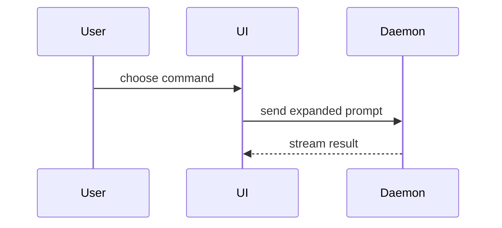

Use this template for writing the PR body:

```markdown
## Summary

<diagram, diff-sketch, or tree>

## Evidence

- **Before:** <screenshot/output/failing test run>
  **After:** <screenshot/output/passing test run>

## Merge Danger

**Door:** <one-way or two-way>

<optional: description>

**Blast Radius:** <one-word description>

<optional: potential ramifications of merge>
```

## Sections

Skip all preambles and keep prose brief. All PR titles and descriptions must follow the **unslop** skill (load its discovered global path; fallback `~/.agents/skills/unslop/SKILL.md`): no decorative emojis in bullets, no AI vocabulary ("delve", "foster", "crucial", "seamlessly"), no superficial `-ing` clauses ("ensuring that..."), no robot formatting, and no chatbot pleasantries. Use the user's domain language from `GLOSSARY.md` if the project has one, otherwise the language the user and repo already use.

### Summary

Pick the smallest view that makes the key point clear.

- Show logic or an algorithm as pseudocode:

```text
on(save)
  if content is unchanged
    return cached result
  write new content
  return fresh result
```

- Show runtime control flow as a call tree:

```text
submitForm
  createSession
    persistPrompt
    launchAgent
  navigateToSession
```

- Show UI structure as a component tree, including state and module boundaries that matter:

```text
<SessionPage> (apps/example/src/routes/session.tsx)
  useSessionEvents()
  <SessionToolbar>
    <RunSkillButton> (packages/ui)
```

- Show file responsibility or a broad refactor as a shallow file tree:

```text
src/
├── commands/       # parses user actions
├── sessions/       # owns session state
└── transport/      # sends API requests
```

- Show component interaction, control flow, or data flow with Mermaid:



- Use `diff` when the point is what changes and the surrounding shape already exists. Match the diff shape to the topic.

For a component change:

```diff
 <SessionPage>
   useSessionEvents()
   <SessionToolbar>
+    <RunSkillButton />
   <SessionTimeline>
+    <SkillResultCard />
```

For a file-layout change:

```diff
 src/
 ├── commands/
+│   └── show-me.ts       # expands the slash command
 ├── sessions/
-└── transport.ts
+└── transport/
+    ├── client.ts
+    └── stream.ts
```

For a call-tree or call-stack change:

```diff
 submitForm
   createSession
     persistPrompt
+    expandSkillMention
     launchAgent
-  navigateToSession
+  navigateToSession
+    subscribeToEvents
```

For a state or control-flow change:

```diff
 on(save)
-  write content
+  if content is unchanged
+    return cached result
+  write new content
+  invalidate cache
```

- Show the whole block when most of it is new, when omitted context would hide ownership or order, or when the user needs a copyable target shape:

```ts
function expandSkill(command: string): string {
  const skillName = command.slice(1);
  return `use the ${skillName} skill`;
}
```

#### Guidance

Place each visual next to the short text it supports. Keep only the calls, files, props, states, and boundaries needed to answer the user's current question or the options to resolve the current discussion point.

You may use one of these, you may use several, it is unlikely you will use all of them. Use your judgement and don't overwhelm the user.

### Evidence

Concrete evidence that the change works. Show a before and after.

**Visible UI changes:** capture screenshots of the implemented UI and embed them in the PR's Evidence section before handoff. Show the changed surface and relevant states; include before/after captures when a baseline is available, otherwise label the missing baseline. Use durable image URLs accessible to reviewers and verify they load. Redact secrets and personal data; label mocked backend state and runtime testing limits. If capture is blocked, explain why and mark screenshot evidence missing rather than silently skipping it.

**UI irrelevant or unchanged:** screenshots are not needed. Use relevant tests, command output, or other execution-based evidence instead. Mixed PRs need screenshots only for their visible UI changes.

### Merge Danger

Describe whether it's a one-way or two-way door. You can walk back through two-way doors, but not one-way doors. A PR that is cheap to roll back is lower risk. Changes that involve destructive actions or hard-to-reverse decisions are one-way doors.

The **Blast Radius** assesses the impact beyond the immediate diff. Do not speculate or hand back unverified adjectives. Follow the **blast-radius** skill (load its discovered global path; fallback `~/.agents/skills/blast-radius/SKILL.md`):
- Identify the **one core safety fact** the change depends on (e.g. *"this only evicts expired cache keys and never drops active sessions"*).
- Prove that fact with running code (a test, probe script, or app execution) instead of asserting it.
- State whether the safety fact is **Proven** (with the check run) or **Unproven**.

### Code Hygiene Before PR

Before opening the PR, run **no-comments** (load its discovered global path; fallback `~/.agents/skills/no-comments/SKILL.md`) for comment-only cleanup of the task diff. Preserve constraints and tool directives. Behavioral changes require separate approval.

## Adapting this into a project's shipping skill

This is a template, not the authority for any one project. When a project needs its own runbook, copy the three sections above into a project skill and add only what is true there:

1. **How this project ships.** Branch rules, what auto-deploys, what must never be pushed directly.
2. **The checks that must pass first.** Real commands only. List the repo's actual guard scripts — never invent a name that sounds right.
3. **What counts as proof here.** Where evidence lives, in what form, and what an honest N/A looks like.

Then name the skill for the project, point at it from `AGENTS.md`, and keep the never-bend rules in `AGENTS.md` rather than in the skill — one authoritative place per rule.

Prune whatever the project does not do. A template copied through unchanged into a project it does not fit is worse than no template, and a stale one is worse still.
